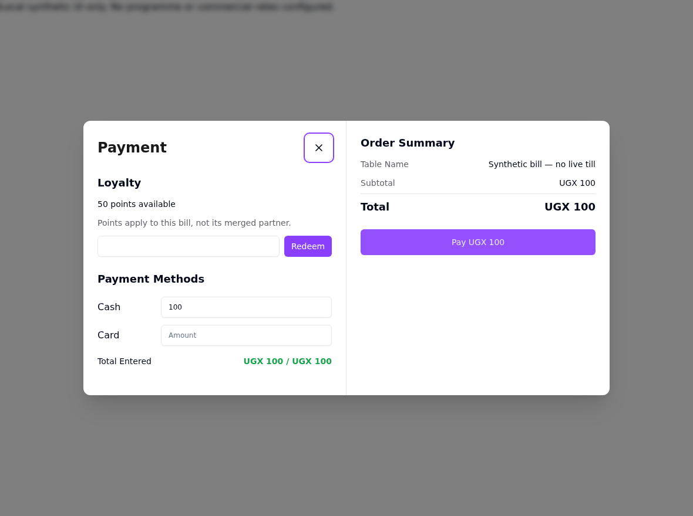
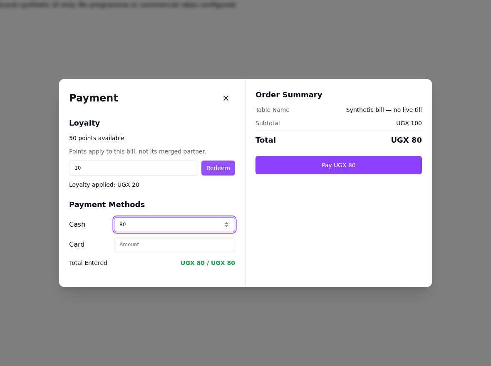
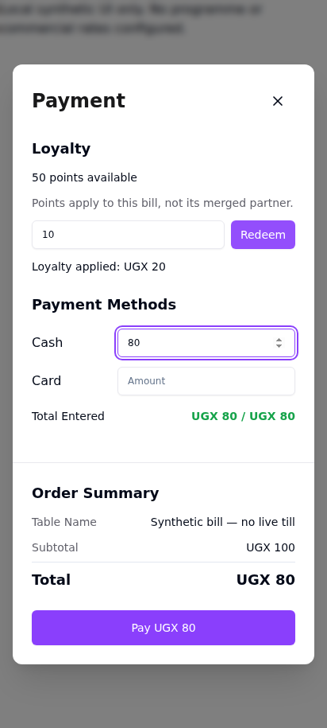

# U4 loyalty: source-only handoff (no activation)

Bounded X3 implementation from `arch-salama-beyond-ezee.md`, including its final security refinement. This is an existing URY/ERPNext seam, not a new service, store, dependency, programme or accounting implementation.

Stack base: U3 `c5a67776d690666d4353d00de11d8bd667935c0b`, branch `codex/salama-u3-hold-fire`, PR #53. Initial PR target must be that branch. Preserve both RED/GREEN pairs using merge commits; do not squash or rebase away the evidence. Parent owns independent integration review and merge.

## Native configuration and S2 handoff

- `POS Profile.ury_enable_loyalty`: native Check custom field, default `0`. Fresh-install definition is in `get_custom_fields()`; the narrow `ury.patches.v2_0.loyalty_profile_field` patch installs only its schema on existing sites. No profile is enabled and no Loyalty Program/rate/account is created. It remains editable through existing authorized `update_draft` on POS Profile; no chat tool or authority change is needed here.
- `ury.ury.doctype.ury_order.ury_order.get_loyalty_redemption(invoice, customer, pos_profile, loyalty_points=0, additionalDiscount=None)`: authenticated read-only quote; returns `enabled`, `balance`, `loyalty_points`, `loyalty_amount`, `amount_due`. Disabled/unenrolled ordinary quotes return only `enabled: false`. No document is saved or ledger entry created. Points apply to the selected bill only; the quoted tender includes its merged partner.
- Existing `ury.ury.doctype.ury_order.ury_order.make_invoice` accepts **points only**, `loyalty_points=0`. It never accepts a client loyalty amount, conversion factor or account. Native ERPNext validates balance/company/bill limits and computes the amount; native totals determine remaining tender; native submit owns ledger writes. Customer locking serializes redemption through this seam. A changed balance is revalidated at settlement.
- Native invoice fields: `loyalty_program`, `redeem_loyalty_points`, `loyalty_points`, `loyalty_amount`, `loyalty_redemption_account`, `loyalty_redemption_cost_center`. The seam clears stale redemption state even when no points are requested. Native programme/account configuration remains outside U4.
- **Parent S2 dependency:** a POS Invoice **Before Submit** configuration gate must use the live `POS Profile.ury_enable_loyalty` flag and enforce the named/non-default/non-Walk-in customer policy. On a disabled/ineligible profile/customer it must refuse redemption and clear `doc.loyalty_program` after native validation has populated it, preventing native earning at `on_submit`. Do not rely on `dont_create_loyalty_points`: the pinned POS Invoice earning hook does not check that Sales Invoice flag. S2 also owns configuration/fence admission; U4 adds no tenant Server Script or allowlist change.

Stable U4 refusals: `URY_LOYALTY_DISABLED`, `URY_LOYALTY_PROFILE`, `URY_LOYALTY_CUSTOMER`, `URY_LOYALTY_POINTS`. Native balance/bill/company/permission refusals remain native. `URY_HELD_NOT_FIRED` remains unchanged, including linked held lines and a hold/fire switch disabled after holding. No held/KOT refactor is included.

Named/default-customer and original-profile checks are server-side. The balance quote also requires invoice read/submit and existing order/branch access; native customer permission checks are retained. Points are never queued as offline cash, including gateway errors. Editing points invalidates the quote; late responses cannot cross bill/customer/profile/discount context. Existing partial-payment policy and merged tender allocation are retained. Loyalty is not spread automatically over merged invoices: native validation caps it at the selected bill.

## Pinned native contracts and qualification boundary

Declared production ERPNext pin: `7474d9e786277383de1242ab882f16856d17a9c9`. Tests execute actual native method bodies from local `frappe-siteops:rel-v16-cc7cf44f`, image ID `sha256:f9de222710a9ec83223a6dd183eb03fc317df86fb662dd1f095308e70970e2a4`. The image has no ERPNext `.git`; this is image-source contract evidence, not a separate Git/runtime attestation. Native source SHA-256 values:

```text
loyalty_program.py f945ae2fa6ec2f77ba7c2c229d5f7cbff11472116c3adc10aaa2268ca1d85c14
pos_invoice.py    d3b30d59508d06f277a90f3547b2c481eeb51955bfdf1e22bb91b4180d1f1b7a
sales_invoice.py  af580ca6fed4626bfc3fcaa96e0f53039fe1d82947e4bb1f8f70ba61270fec76
```

Contracts used: `get_loyalty_program_details_with_points` with the explicit enrolled programme; `validate_loyalty_points` with an empty server-owned amount; `POSInvoice.validate_loyalty_transaction`; native totals/paid/outstanding methods; `POSInvoice.on_submit` and inherited earning/redemption methods. Pinned `SalesInvoice.on_submit` excludes `is_consolidated` from earning and redemption; the regression executes that native hook and confirms no second ledger posting.

**FAIL financial qualification / no commercial enablement.** Independent review found no actionable U4 source defect, but identified three native blockers:

1. **Cross-invoice-type point pool:** the native balance includes all invoice types (`loyalty_program.py:59-79,194-205`), while `SalesInvoice.apply_loyalty_points` skips sources whose `invoice_type` differs from the redeeming POS Invoice (`sales_invoice.py:2242`). A Sales-Invoice-origin balance can therefore reduce tender without being consumed. The isolated image-backed probe uses explicit fake persistence (`native-gap-probe.log`):

```text
NATIVE_GAP sales-origin balance accepted: loyalty_points=10 loyalty_amount=20.0 redemption_entries=0
```

2. **Signed prior-redemption allocation:** `get_redemption_details` returns signed negative redemptions, but `apply_loyalty_points` subtracts them from the source balance (`sales_invoice.py:2246`). With E1 earning 50 and already redeemed by 30, plus E2 earning 50, native redemption allocates a new 40 entirely to E1 instead of 20 to each. Redemption inherits the source expiry (`:2263`), so this can distort later balances as sources expire. The independent verifier reproduced it and the implementer replayed the same actual-native-method probe (`verifier-signed-probe.py`, `verifier-signed-probe.log`):

```text
SIGNED_PROBE allocations: [('E1', -40)] expected [('E1', -20), ('E2', -20)]
```

3. **Consolidation accounting: CANNOT-VERIFY / blocking:** native totals count loyalty as paid (`controllers/taxes_and_totals.py:1146-1148`), the merge log aggregates loyalty values, and native `make_loyalty_point_redemption_gle` excludes consolidated invoices (`sales_invoice.py:1841`). POS Invoice does not independently post GL. Source review therefore flags a potential unreconciled customer balance/missing redemption expense after closing/consolidation. A database-backed native accounting check is required; this is not a reproduced live/GL failure. `test_native_consolidated_invoice_does_not_post_points_again` proves no second points-ledger posting only, not accounting correctness.

These are qualification blockers, not passing financial acceptance tests. Native resolution/qualification is required for blockers 1 and 2, and native database-backed closing/consolidation/GL evidence for blocker 3. No compensating URY ledger, allocation, conversion or accounting code was written. Do not activate loyalty or treat synthetic POS-origin tests as financial qualification.

No native bench/database, migrated metadata, ordinary-user DocPerm, concurrent native transaction, real till, consolidation/GL or commercial accounting acceptance is claimed. Parent S2 and native qualification remain release/enablement gates. No Salama Rewards, rates, Accounts Settings, live accounting, host deployment, tenant fixtures or database writes were performed.

Primary UX references: [ERPNext POS loyalty redemption](https://docs.frappe.io/erpnext/loyalty-points-redemption-in-pos), [SAP Customer Checkout loyalty configuration](https://help.sap.com/docs/SAP_CUSTOMER_CHECKOUT/8f711df7d2aa4f1aa29f88c86cef2081/ea98c7605e1f4ddfa9f185b058c10e02.html), [ERPNext pinned native helper](https://github.com/frappe/erpnext/blob/7474d9e786277383de1242ab882f16856d17a9c9/erpnext/accounts/doctype/loyalty_program/loyalty_program.py). The till presents balance, a points input and Redeem, using existing URY UI primitives, not editable conversion/rate controls.

## RED/GREEN evidence and local checks

Evidence directory: `/tmp/ury-u4.XhqCtG`. Production source at `ada5c51d95e3c05d405931d90917492142f62643`; later documentation/screenshots do not change it.

```text
8233cc7d RED   native settlement/balance/till tests: 21 tests, 28 assertion failures including subtests, no errors; UI 5 failed / 6 passed
6caf0816 GREEN image-backed 21 passed; focused UI 35 passed
5ff4760f RED   loyalty shown as negative rounding adjustment: UI 1 failed / 10 passed
ada5c51d GREEN focused UI 35 passed; no new lint diagnostics
```

Captured RED output demonstrates missing behavior, not a harness/import failure:

```text
test_native_redemption_reduces_cash_due_and_native_submit_posts_once ... FAIL
AssertionError: Tuples differ: (0, 0, 0.0, 100.0) != (10, 20, 100, 0)
test_over_balance_is_refused_before_any_save ... FAIL
AssertionError: ValueError not raised
named customer sees native balance and redeem input ... FAIL
AssertionError: expected 'PaymentPayment MethodsCashCardTotal E…' to contain '50 points available'
```

The native rounding function reads a database-backed system setting. The site-less harness supplies that setting, not replacement arithmetic. A fresh final-harness rerun against the **unchanged U3 production files**, mounted read-only over the candidate, still yields `Ran 22 tests; FAILED (failures=28)` with no errors (`red-native-recheck.log`). Native dependencies/clock/DB doubles are explicit; no test or mandatory dependency is skipped.

Toolchain: Node 24.20.0; Vitest 3.2.6; Vite 6.4.3; image Python 3.14.7; existing SiteOps Ruff (no tools installed). Baseline and candidate have isolated `npm ci --ignore-scripts` dependencies from the unchanged lockfile. Directory-level comparisons:

```text
Configured POS Vitest directory: U3 578 passed, U4 589 passed; no failures/skips, zero removed identities, 11 added
Separate POS Node directory tests: U3 36 passed, U4 36 passed; no failures/skips
Focused PaymentDialog + loyalty: 35 passed
Image-backed U1/U3/backend regression selection: U3 68 passed, U4 90 passed
Full POS TypeScript: 11 baseline / 11 candidate diagnostics, no new diagnostics (NOT a green typecheck)
Full POS ESLint: 156 errors / 56 warnings on both, identical findings (NOT a green lint run)
Touched existing Python: 57 Ruff diagnostics on both, identical findings; new Python files clean
POS production build into /tmp: PASS, including worker injectManifest; existing chunk-size warning
git diff --check: PASS
CodeRabbit advisory attempt: CANNOT-VERIFY, HTTP 403 Invalid organization; no account settings changed
```

Reproduction commands (worktree root; use the same commands from the archived U3 root for comparison):

```bash
/home/paulmwanje/.nvm/versions/node/v24.20.0/bin/node node_modules/vitest/vitest.mjs run --config pos/vitest.config.ts pos/tests
/home/paulmwanje/.nvm/versions/node/v24.20.0/bin/node node_modules/vitest/vitest.mjs run --config pos/vitest.config.ts pos/tests/loyalty-payment.test.tsx pos/tests/PaymentDialog.test.tsx
/home/paulmwanje/.nvm/versions/node/v24.20.0/bin/node --test pos/tests/*.test.cjs pos/tests/*.test.mjs pos/tests/logout.test.ts pos/tests/order-tabs.test.ts
docker run --rm --network none --read-only -e PYTHONDONTWRITEBYTECODE=1 -e PYTHONPATH=/workspace -v /home/paulmwanje/work/ury-u4-loyalty:/workspace:ro -w /workspace --entrypoint /home/frappe/frappe-bench/env/bin/python frappe-siteops:rel-v16-cc7cf44f -m unittest ury.ury.api.test_ury_kot_notes ury.ury.api.test_ury_hold_fire ury.ury.api.test_ury_loyalty -v
```

## Independent verification

Configured `verification-specialist`, `cp-claude-opus-5-5`, high, reviewed production source `ada5c51d95e3c05d405931d90917492142f62643` read-only. Verdict: **source/tests pass, no actionable U4 source defect; FAIL financial qualification** for the three native blockers above. It independently ran focused POS (35 passed), complete configured POS directory (589 passed), backend selection (90 passed), original/corrected backend RED (28 failures, zero errors), and both frontend REDs (5 failed; then 1 failed / 10 passed). It reran base/candidate TypeScript and ESLint with no changed findings and compared Ruff with no changes. Canonical tool counts remain 11 TS errors, 156 ESLint errors / 56 warnings and 57 Ruff findings; the report's 12/215/59 text-line counts include continuation/summary lines, not additional findings.

The verifier also read the handoff and inspected `redeemed.png`. Full report/logs: `/tmp/ury-u4.XhqCtG/verification.md`, `verification-run.log`, `verifier-*`. Its initial read-only sandbox could not create its network namespace (`bwrap: loopback: Failed RTM_NEWADDR: Operation not permitted`), correctly CANNOT-VERIFY; the same configured role/model then ran under the available host runner after an exact-SHA command smoke test, under strictly read-only task boundaries. This is not a native multi-agent route-health claim. Parent independent integration review and merge remain required; do not self-merge.

The reviewer noted walk-in name matching and seam-local Customer locking as mild extra checks. The user explicitly requires no Walk-in redemption and stale-point refusal, so these bounded guards are retained; they do not replace native configuration or serialize other native settlement paths. The GREEN harness-only rounding-setting stub changes no assertion; the consolidated-submit characterization added with the second RED is explicitly not claimed as its failure.

## Local dev-server screenshots

Actual PaymentDialog and stores under Vite, synthetic named customer/profile/bill only. Playwright intercepts every API request and rejects external requests. It asserts balance -> Redeem -> cash 80 plus 10 points, no client amount/rate, and no page errors. No live service or database is contacted. These fixture values are not proposed commercial rates. Harness and browser output are in the evidence directory.




